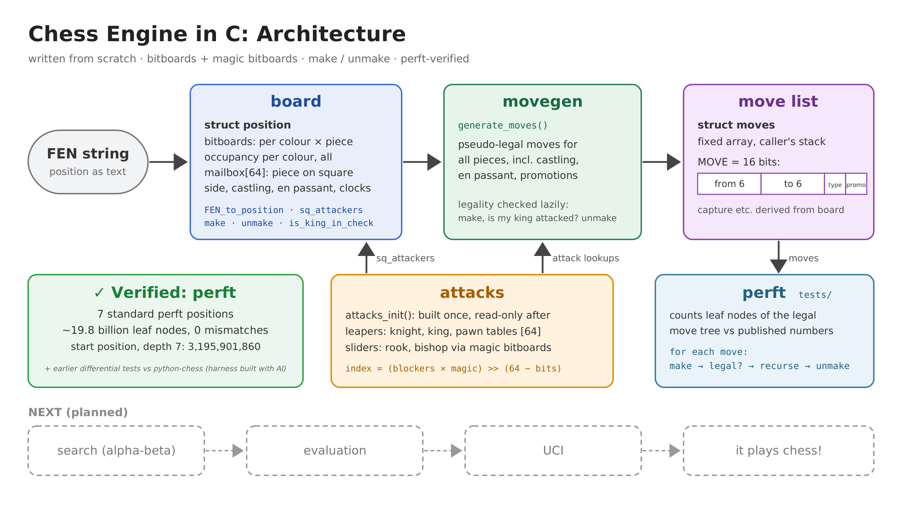

# Chess-engine-C

A chess engine I'm writing from scratch in C. I picked C on purpose, because it was the language I felt least confident in. So: bitboards, magic numbers, the whole low-level thing. 1,000+ lines so far, every one of them written by hand.



## Where it's at

The board layer is **done and verified**. It doesn't play chess yet, that's the next part.

- **Board:** bitboards per colour per piece, plus a mailbox. FEN parsing.
- **Attacks:** lookup tables for knight, king and pawns. **Magic bitboards** for sliders, magics found at startup.
- **Move generation:** pseudo-legal moves for everything, incl. castling, en passant and promotions, packed into 16 bits.
- **make / unmake:** saves just enough info to undo any move.
- **Legality:** lazy. Make the move, check if your king is hanging, unmake.

## Does it actually work?

Yep. Perft counts every legal move sequence up to depth N and compares it to the known numbers. It passes all 7 standard test positions:

| Position | Depth | Nodes |
|---|---|---|
| Start position | 7 | 3,195,901,860 |
| Kiwipete | 6 | 8,031,647,685 |
| Position 3 | 7 | 178,633,661 |
| Position 4 | 6 | 706,045,033 |
| Position 4 (mirrored) | 6 | 706,045,033 |
| Position 5 | 5 | 89,941,194 |
| Position 6 | 6 | 6,923,051,137 |

That's ~19.8 billion leaf nodes, 0 mismatches.

Before that, move generation and make/unmake were also cross-checked against python-chess (that test harness was built with AI).

## Build & run

Needs gcc and make.

```
make        # builds build/bin/engine (does nothing yet)
make test   # runs the perft suite
```

Heads up: the full suite takes a few minutes. Good time for a coffee. On Windows with MSYS2 the command is `mingw32-make`.

## Next

search (alpha-beta) → evaluation → UCI → actually playing chess.
